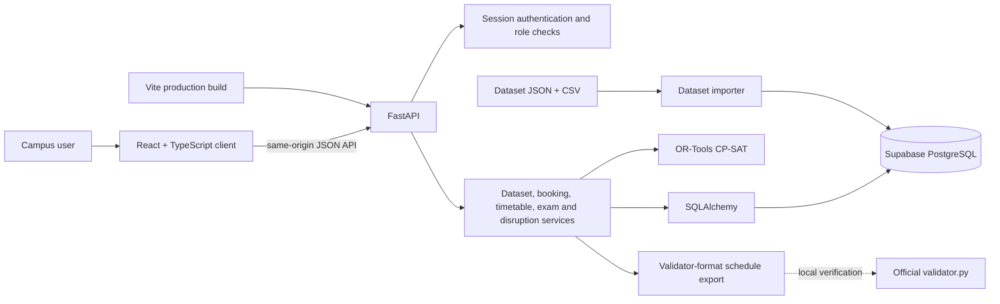

# AXIOM

AXIOM is an Intelligent Campus Scheduling and Venue Management Platform built for the Crunch Week hackathon. This repository preserves the official starter pack and provides a runnable foundation for the team. The application reads the supplied dataset as input; it does not embed dataset records in code.

The starter pack guide is preserved at [docs/STARTER_PACK_README.md](docs/STARTER_PACK_README.md).

## Architecture



In production, the Render Docker service builds the Vite client and FastAPI serves the static client and API from one origin. PostgreSQL is hosted by Supabase; credentials stay in the backend environment. The official validator is a local submission check, not an API service.

## Technology stack

| Area | Technology |
| --- | --- |
| Frontend | React, TypeScript, Vite |
| Backend API | Python, FastAPI, Pydantic |
| Database and ORM | Supabase PostgreSQL, SQLAlchemy, Psycopg |
| Schema migrations | Alembic |
| Timetable optimization | Google OR-Tools CP-SAT |
| Deployment | Render Docker web service |

## Repository contents

- `backend/` — FastAPI, SQLAlchemy, Alembic, Pydantic settings, and service boundaries.
- `frontend/` — React, TypeScript, and Vite starter workspace.
- `data/` — official CIT dataset and CSV copies from the starter pack.
- `examples/` — official schedule, disruption, and sample request examples.
- `validator.py` — unmodified official validator.
- `docs/` — team ownership, API contracts, and database schema notes.

## Requirements

- Python 3.10 or newer (3.8+ is sufficient for the official validator).
- Node.js 20.19+ or 22.12+ and npm.
- PostgreSQL 14+; configure `DATABASE_URL` for the API and dataset importer.

## Backend setup

From the repository root, create and activate a virtual environment, then install dependencies:

```powershell
cd backend
python -m venv .venv
.\.venv\Scripts\Activate.ps1
pip install -r requirements.txt
Copy-Item ..\.env.example .env
uvicorn app.main:app --reload
```

On macOS/Linux, activate with `source .venv/bin/activate`. Configure `DATABASE_URL` in `backend/.env`. API docs are at `http://localhost:8000/docs`; health check: `http://localhost:8000/api/v1/health`.

### Import a dataset

The dataset import runs in one database transaction and can be repeated safely. The default source is `data/cit_public.json`; use the API request body to select another JSON file or a directory containing exactly one dataset JSON. File paths must stay under the repository `data/` directory.

```powershell
Invoke-RestMethod -Method Post -Uri http://localhost:8000/api/v1/datasets/import `
  -ContentType 'application/json' -Body '{"path":"cit_public.json"}'
Invoke-RestMethod http://localhost:8000/api/v1/datasets
Invoke-RestMethod http://localhost:8000/api/v1/datasets/<dataset-uuid>
```

`GET /api/v1/datasets` lists imported datasets; `GET /api/v1/datasets/{dataset_id}` returns dataset metadata. The import response includes per-table input counts. CSV collections can supplement dataset JSON when a collection is absent.

### Run the deterministic booking engine

Booking decisions are evaluated against a `Schedule` belonging to the same dataset. The schedule supplies regular timetable room and student-group occupancy; the engine does not create or solve a timetable. After a schedule exists, run decisions with:

```powershell
Invoke-RestMethod -Method Post -Uri http://localhost:8000/api/v1/datasets/<dataset-uuid>/schedules/<schedule-uuid>/bookings/run
Invoke-RestMethod http://localhost:8000/api/v1/datasets/<dataset-uuid>/schedules/<schedule-uuid>/booking-outcomes
```

The run endpoint applies dataset priority order and role caps, checks cancellations, room constraints, unavailability, timetable/group conflicts and earlier approvals, then transactionally upserts one outcome per request. The outcomes endpoint includes requests without a decision as `pending`. See [docs/BOOKING_ENGINE.md](docs/BOOKING_ENGINE.md) for the rules.

## Frontend setup

In another terminal from the repository root:

```powershell
cd frontend
npm ci
Copy-Item .env.example .env.local
npm run dev
```

Vite prints the local app URL (normally `http://localhost:5173`). `VITE_API_URL` in `frontend/.env.local` controls the backend base URL. The public landing page is available at `/`; sign-in at `/login` uses the backend's HttpOnly session cookie. Protected navigation is based on the role returned by the server. See [frontend setup](frontend/README.md) and [role access and demo account setup](docs/ROLE_ACCESS.md).

## Deployment

The public repository is [github.com/dhruv-asati/AXIOM](https://github.com/dhruv-asati/AXIOM), and the public demo is [axiom-5uf0.onrender.com](https://axiom-5uf0.onrender.com). The repository includes a root Dockerfile and Render Blueprint for one Docker web service. FastAPI serves the production-built React app and API from the same origin. The configured Render Free service can sleep after inactivity, so allow time for a cold start. A public readiness endpoint is intended to check database connectivity; verify it and authenticated workflows on the deployed version after deployment. Database migrations remain manual and are never run at application startup. See [the Render deployment guide](docs/DEPLOYMENT_RENDER.md).

## Authentication and demo accounts

AXIOM supports four roles: `admin`, `department_coordinator`, `faculty`, and `club_representative`. The demo instance has these pre-provisioned usernames; passwords are shared privately and are intentionally not stored in this repository:

| Username | Role |
| --- | --- |
| `admin` | Campus administrator |
| `coordinator` | Department coordinator |
| `faculty` | Faculty member |
| `robotics` | Club representative |

The project operator reports that these accounts are provisioned in the demo environment; this repository cannot verify live account state. Do not run the provisioning command or reset their passwords as part of ordinary demo setup. For a separately controlled environment, see [role access and account provisioning](docs/ROLE_ACCESS.md); never commit populated account JSON or share passwords publicly.

## Database migrations

Alembic is configured in `backend/alembic.ini`. The repository migration chain is `415e1b5d6866` → `8c41d892c2aa` → `cd9a2f1b7e40` → `31c4d6a2f809` → `4a92d6c1e7b0` → `f6e774ed4a42`. The project operator's latest reported Supabase revision is `f6e774ed4a42`; this README does not substitute for checking a target database. Inspect the current revision read-only before planning any schema change. Migration commands, if intentionally needed in a separately approved environment, are:

```powershell
alembic revision --autogenerate -m "describe schema"
alembic upgrade head
```

Migrations are never applied automatically. Do not run `upgrade` or `downgrade` against the demo Supabase database as part of setup. Confirm `DATABASE_URL`, inspect the current revision, and take a backup before a separately approved migration. Downgrades can remove application data.

## Generate and validate a timetable

The timetable solver uses OR-Tools CP-SAT and reads all inputs from the selected imported dataset. It writes a complete schedule and exam room allocations to PostgreSQL. The generated JSON export includes weekly sessions and exams in the official validator format:

```powershell
$datasetId = '<dataset-uuid>'
$result = Invoke-RestMethod -Method Post -Uri "http://localhost:8000/api/v1/datasets/$datasetId/schedules/generate" `
  -ContentType 'application/json' -Body '{"team":"AXIOM","time_limit_seconds":120}'
$scheduleId = $result.schedule_id
Invoke-RestMethod "http://localhost:8000/api/v1/datasets/$datasetId/schedules/$scheduleId/assignments"
Invoke-RestMethod "http://localhost:8000/api/v1/datasets/$datasetId/schedules/$scheduleId/export" |
  ConvertTo-Json -Depth 30 | Set-Content ..\exports\schedule.json
python ..\validator.py --data ..\data\cit_public.json --schedule ..\exports\schedule.json
```

`status` is `optimal` only when CP-SAT proves the best soft score, and `feasible` when it finds a complete hard-valid timetable but has not proved optimality within the time limit. Infeasible inputs return HTTP 422 without persisting a partial schedule. See [docs/TIMETABLE_SOLVER.md](docs/TIMETABLE_SOLVER.md) for constraints and scoring weights.

## Team workflow and exports

See [Team structure](docs/TEAM_STRUCTURE.md), [API contracts](docs/API_CONTRACTS.md), and the implemented [backend API integration guide](docs/API_INTEGRATION.md). Keep generated judge-format outputs under `exports/`. Use the official validator exactly as described in the starter README:

```powershell
python validator.py --data data/cit_public.json --schedule exports/schedule.json
```

`exports/schedule.json` is the baseline weekly timetable. `exports/schedule_after.json`, when present, is the result of applying `examples/sample_disruption.json` through the disruption repair workflow. Validate the pair with the official validator's disruption comparison mode:

```powershell
python validator.py --data data/cit_public.json --schedule exports/schedule_after.json --disruption examples/sample_disruption.json --baseline exports/schedule.json
```

The validator reports hard violations separately from soft-constraint penalties. Do not treat a missing export or an unverified output as a valid schedule.

## Campus operations workflow

The application now includes dataset management, timetable generation and review, room directory and utilisation, examination allocations, booking review and deterministic booking decisions, a review-only request assistant, and disruption repair proposals. From the UI, use **Datasets** to import JSON plus optional CSV supplements, select the dataset in the top bar, generate a schedule in **Timetable**, then review bookings, examinations and rooms. Disruption proposals are solver-generated previews; approving one explicitly creates a new schedule and preserves the baseline.

The assistant is a deterministic parser and proposal handoff. It does not approve bookings or disruptions. Four-role authentication and authorization are implemented. Dashboard and analytics values are read from the backend. Live room occupancy is intentionally shown as unavailable because no check-in telemetry source is connected. Timetable generation requires a feasible uploaded dataset; it returns an infeasible result rather than treating a partial schedule as valid.

### Import through the application

Open `http://localhost:5173/datasets`. Select the dataset JSON and, if applicable, its CSV supplement files. Replacing a dataset with an existing source ID requires a separate confirmation. The API accepts one JSON file and CSV files through `POST /api/v1/datasets/import/upload` and validates the import before commit.

### Migration safety

The deployment's schema is managed separately from application startup. Before any schema work, run a read-only `alembic current` against the specifically intended target and compare it with the migration chain above. Preview and review SQL before an intentionally approved migration; never infer the live database revision from local files. Do not run migrations as part of demo setup.

### Backend tests and frontend build

```powershell
cd backend
python -m pytest -q
cd ..\frontend
npm run build
```

See [docs/API_INTEGRATION.md](docs/API_INTEGRATION.md), [docs/TIMETABLE_SOLVER.md](docs/TIMETABLE_SOLVER.md), and [docs/STAGE_12_END_TO_END_REPORT.md](docs/STAGE_12_END_TO_END_REPORT.md) for endpoint details and verified limitations.


